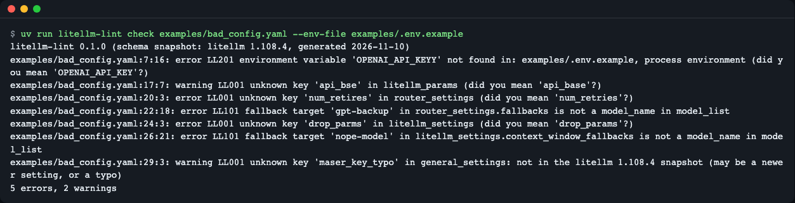
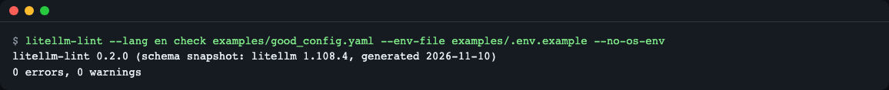
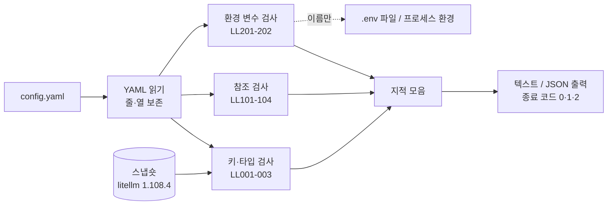

# litellm-lint

[English](README.md) | **한국어**

LiteLLM 프록시는 설정 파일의 오타를 조용히 넘기는 경우가 많습니다. 이 도구는 프록시를 띄우기 전에 `config.yaml` 을 읽어 그런 실수를 줄 번호와 함께 알려 줍니다. 프록시를 실행하지 않고, 네트워크도 쓰지 않고, 키 값도 읽어 출력하지 않습니다.

> 비공식 도구입니다. 검사 기준은 **litellm 1.108.4** 에서 뽑아 둔 스냅숏입니다(아래 "지원 버전과 한계").


*오타·없는 환경 변수 5건과 끊어진 폴백 2건을 줄 번호와 함께 보여 주는 `litellm-lint check` 출력*

## 이런 분께
- 배포 전에 `config.yaml` 을 CI 나 pre-commit 에서 자동으로 확인하고 싶을 때
- `num_retires` 같은 오타가 에러 없이 무시된 경험이 있을 때
- `fallbacks` 에 적은 모델 이름이 `model_list` 에 실제로 있는지 확인하고 싶을 때
- `os.environ/NAME` 으로 적은 환경 변수가 배포 환경에 정의돼 있는지 미리 보고 싶을 때

## 설치
```bash
curl -LsSf https://astral.sh/uv/install.sh | sh        # uv 가 없다면 (Python 3.10 이상 필요)
uv tool install git+https://github.com/LeeGyeongPil/litellm-lint
litellm-lint --version
```
```
litellm-lint 0.1.1 (schema snapshot: litellm 1.108.4)
```
설치 없이 한 번만 돌려 보려면 `uvx --from git+https://github.com/LeeGyeongPil/litellm-lint litellm-lint check config.yaml`. 레포를 받아 직접 쓰려면 `git clone` 후 `uv run litellm-lint ...`. 최소 리눅스 이미지에는 `git` 과 `curl` 이 필요합니다.

## 빠르게 시작하기
레포의 예제로 바로 해 볼 수 있습니다.
```bash
git clone https://github.com/LeeGyeongPil/litellm-lint && cd litellm-lint
uv run litellm-lint check examples/bad_config.yaml --env-file examples/.env.example
```
```
litellm-lint 0.1.1 (schema snapshot: litellm 1.108.4, generated 2026-11-10)
examples/bad_config.yaml:7:16: error LL201 environment variable 'OPENAI_API_KEYY' not found in: examples/.env.example, process environment (did you mean 'OPENAI_API_KEY'?)
examples/bad_config.yaml:17:7: warning LL001 unknown key 'api_bse' in litellm_params (did you mean 'api_base'?)
examples/bad_config.yaml:20:3: error LL001 unknown key 'num_retires' in router_settings (did you mean 'num_retries'?)
examples/bad_config.yaml:22:18: error LL101 fallback target 'gpt-backup' in router_settings.fallbacks is not a model_name in model_list
examples/bad_config.yaml:24:3: error LL001 unknown key 'drop_parms' in litellm_settings (did you mean 'drop_params'?)
examples/bad_config.yaml:26:21: error LL101 fallback target 'nope-model' in litellm_settings.context_window_fallbacks is not a model_name in model_list
examples/bad_config.yaml:29:3: warning LL001 unknown key 'maser_key_typo' in general_settings: not in the litellm 1.108.4 snapshot (may be a newer setting, or a typo)
5 errors, 2 warnings
```
각 줄은 `파일:줄:열: 심각도 규칙코드 메시지` 입니다. 종료 코드는 오류가 있으면 1 입니다. 문제없는 설정은 이렇게 끝납니다.
```bash
uv run litellm-lint check examples/good_config.yaml --env-file examples/.env.example
```
```
litellm-lint 0.1.1 (schema snapshot: litellm 1.108.4, generated 2026-11-10)
0 errors, 0 warnings
```

*오류도 경고도 없으면 종료 코드 0*

## 사용법
```
litellm-lint check [--env-file PATH] [--no-os-env] [--strict] [--ignore CODES] [--format {text,json}] config [config ...]
litellm-lint schema [-o PATH]
litellm-lint --version
```

| 명령·옵션 | 하는 일 | 예 |
|---|---|---|
| `check <config> [more ...]` | 설정을 검사하고 지적을 출력. 파일 여러 개 가능 | `litellm-lint check a.yaml b.yaml` |
| `--env-file PATH` | dotenv 파일에 적힌 **이름**을 "정의됨"으로 침(여러 번 가능) | `--env-file .env.prod` |
| `--no-os-env` | 지금 셸의 환경 변수는 정의된 것으로 치지 않음 | CI 에서 `.env` 만 기준으로 볼 때 |
| `--strict` | 경고에도 종료 코드 1 | `--strict` |
| `--ignore CODES` | 쉼표로 구분한 규칙 코드를 건너뜀 | `--ignore LL001,LL402` |
| `--format json` | 기계가 읽는 JSON 출력(파일이 여러 개면 파일별 객체의 배열) | `--format json` |
| `schema -o PATH` | 편집기용 JSON Schema(Draft 2020-12) 내보내기 | `schema -o litellm.schema.json` |

종료 코드: `0` 문제 없음(또는 경고만), `1` 오류 있음(`--strict` 면 경고 포함), `2` 사용법 오류 또는 입력을 읽을 수 없음(YAML 구문 오류, 없거나 깨진 `include` 파일, 너무 깊거나 큰 입력 = LL900). 파일이 여러 개면 가장 나쁜 값(2 > 1 > 0)이 종료 코드입니다.

파일을 여러 개 주면 헤더는 한 번만 나오고, 파일마다 지적과 요약 줄, 마지막에 `total` 줄이 붙습니다.
```bash
uv run litellm-lint check examples/good_config.yaml examples/bad_config.yaml --env-file examples/.env.example
```
```
litellm-lint 0.1.1 (schema snapshot: litellm 1.108.4, generated 2026-11-10)
examples/good_config.yaml: 0 errors, 0 warnings
examples/bad_config.yaml:7:16: error LL201 environment variable 'OPENAI_API_KEYY' not found in: examples/.env.example, process environment (did you mean 'OPENAI_API_KEY'?)
examples/bad_config.yaml:17:7: warning LL001 unknown key 'api_bse' in litellm_params (did you mean 'api_base'?)
examples/bad_config.yaml:20:3: error LL001 unknown key 'num_retires' in router_settings (did you mean 'num_retries'?)
examples/bad_config.yaml:22:18: error LL101 fallback target 'gpt-backup' in router_settings.fallbacks is not a model_name in model_list
examples/bad_config.yaml:24:3: error LL001 unknown key 'drop_parms' in litellm_settings (did you mean 'drop_params'?)
examples/bad_config.yaml:26:21: error LL101 fallback target 'nope-model' in litellm_settings.context_window_fallbacks is not a model_name in model_list
examples/bad_config.yaml:29:3: warning LL001 unknown key 'maser_key_typo' in general_settings: not in the litellm 1.108.4 snapshot (may be a newer setting, or a typo)
examples/bad_config.yaml: 5 errors, 2 warnings
total: 2 files, 5 errors, 2 warnings
```

**시나리오 1 — 배포 파이프라인에서 막기.** `.env` 가 없는 CI 에서는 `--no-os-env --env-file deploy.env.example` 처럼 "배포 환경에 있어야 할 변수 이름 목록"을 기준으로 삼습니다. 아래는 `--ignore LL001` 로 오타 규칙을 끄고 환경 변수를 하나도 주지 않은 경우입니다.
```bash
uv run litellm-lint check examples/bad_config.yaml --no-os-env --ignore LL001
```
```
litellm-lint 0.1.1 (schema snapshot: litellm 1.108.4, generated 2026-11-10)
examples/bad_config.yaml:7:16: error LL201 environment variable 'OPENAI_API_KEYY' not found in: no sources
examples/bad_config.yaml:12:16: error LL201 environment variable 'OPENAI_API_KEY' not found in: no sources
examples/bad_config.yaml:22:18: error LL101 fallback target 'gpt-backup' in router_settings.fallbacks is not a model_name in model_list
examples/bad_config.yaml:26:21: error LL101 fallback target 'nope-model' in litellm_settings.context_window_fallbacks is not a model_name in model_list
examples/bad_config.yaml:28:15: error LL201 environment variable 'LITELLM_MASTER_KEY' not found in: no sources
5 errors, 0 warnings
```
정의된 환경 변수가 하나도 없으니 `os.environ/` 로 참조한 이름 3곳이 모두 LL201 로 잡힙니다.

**시나리오 2 — JSON 으로 다른 도구에 넘기기.** `--format json` 은 (파일 하나면 객체 하나, 여러 개면 객체의 배열로) `tool`, `version`, `snapshot`, `file`, `summary`, `diagnostics[]`(code, severity, message, file, line, column, key, suggestion)를 냅니다.
```bash
uv run litellm-lint check examples/good_config.yaml --env-file examples/.env.example --format json
```
```json
{
  "tool": "litellm-lint",
  "version": "0.1.1",
  "snapshot": {
    "litellm_version": "1.108.4",
    "generated_at": "2026-11-10"
  },
  "file": "examples/good_config.yaml",
  "summary": {
    "errors": 0,
    "warnings": 0,
    "info": 0
  },
  "diagnostics": []
}
```

**시나리오 3 — 편집기에서 바로 보기.** `litellm-lint schema -o litellm.schema.json` 으로 JSON Schema 를 만들어 YAML 편집기(예: VS Code 의 YAML 확장)에 연결하면 키 이름과 타입 오류를 저장 전에 볼 수 있습니다. 폴백·별칭·환경 변수 같은 **참조 검사는 스키마로 표현할 수 없어** `check` 에서만 됩니다.

**시나리오 4 — pre-commit.** 이 레포는 `.pre-commit-hooks.yaml` 을 제공합니다. 파일 이름이 `config*.yaml` 인 것만 검사하고, 한 번에 바뀐 파일을 모두 받습니다. 개발자 셸에는 API 키가 없는 경우가 많으므로, 아래처럼 `--no-os-env --env-file` 로 "배포 환경에 있어야 할 변수 이름 목록"(`deploy.env.example`, 이름만 적은 dotenv 파일)을 기준으로 삼으면 `os.environ/` 참조가 LL201 로 커밋을 막지 않습니다.
```yaml
repos:
  - repo: https://github.com/LeeGyeongPil/litellm-lint
    rev: v0.1.1
    hooks:
      - id: litellm-lint
        args: [--no-os-env, --env-file, deploy.env.example]
```

**Python 에서.** 공개 API 는 `check_file`, `export_schema`, `Diagnostic`, `Report`, `Severity`, `LintUsageError` 입니다.

```python
from litellm_lint import check_file

report = check_file("examples/bad_config.yaml", env_files=["examples/.env.example"], use_os_env=False)
for d in sorted(report.diagnostics, key=lambda d: (d.line or 0, d.code)):
    print(d.line, d.code, d.message)
```

`report.diagnostics` 는 줄 번호 순으로 정렬되어 있지 않아서 위처럼 직접 정렬합니다. 출력은 7건이며 첫 줄은 다음과 같습니다(위 `check` 결과와 같은 지적).

```text
7 LL201 environment variable 'OPENAI_API_KEYY' not found in: examples/.env.example (did you mean 'OPENAI_API_KEY'?)
```

## 설정
설정 파일은 따로 없습니다. 동작은 위 옵션으로만 정합니다.
- 환경 변수 **값은 읽어도 출력하지 않습니다.** 이름만 확인합니다. `examples/.env.example` 은 가짜 값이 든 예시이고, 도구는 그 안의 이름만 봅니다.
- LL201 은 `--env-file` 들, 설정 안의 `environment_variables`, (`--no-os-env` 를 주지 않았다면) 현재 프로세스 환경 순으로 이름을 찾습니다.
- API 키가 필요 없습니다. litellm 도 설치할 필요가 없습니다.

## 규칙 코드
| 코드 | 기본 심각도 | 무엇을 잡나 |
|---|---|---|
| LL000 | info | 설치된 litellm 버전이 스냅숏(1.108.4)과 다름. 패키지 메타데이터만 읽고 litellm 을 import 하지 않음 |
| LL001 | error / warning / info | 모르는 키. 같은 섹션의 비슷한 키가 있거나 다른 섹션에 있는 키면 error + 제안, 비슷한 게 없으면 warning(새 버전 키일 수 있음). `litellm_params` 안에서는 제안이 있으면 warning, 없으면 info |
| LL002 | error | 타입·구조 오류(`num_retries: three`, `default_fallbacks: "gpt-main"`, 매핑이 아닌 섹션, 폴백 리스트 원소가 `{출발: [대상, ...]}` 모양이 아님, `include` 가 경로 리스트가 아님, 문자열이 아닌 최상위 키, `model_name`·`litellm_params`·`model` 이 없는 `model_list` 항목). `os.environ/NAME`·숫자 문자열·빈 값은 허용 |
| LL003 | error | `router_settings` 에 둔 `health_check_interval`/`health_check_concurrency`. 프록시가 기동을 거부함, `general_settings` 로 옮길 것 |
| LL101 | error | `fallbacks`·`context_window_fallbacks`·`content_policy_fallbacks`·`default_fallbacks` 의 대상이 `model_name` 이 아님(와일드카드·별칭은 인정). `store_model_in_db: true` 이거나 `model_list` 가 비어 있으면 warning |
| LL102 | warning | 폴백의 출발 그룹이 `model_name` 이 아님(`"*"` 은 허용) |
| LL103 | error | `model_group_alias` 가 없는 그룹을 가리킴 |
| LL104 | warning | `model_group_retry_policy` 의 그룹이 `model_name` 이 아님 |
| LL201 | error | `os.environ/NAME` 이 어디에도 정의되지 않음. `key_management_system` 이 설정돼 있으면 info |
| LL202 | warning | `api_key`, `*_password`, `*_secret`, `*_token` 같은 키에 값을 직접 적음. 값은 출력하지 않음 |
| LL301 | error | `general_settings.master_key` 가 **비어 있거나 공개된 예시 키**. 우회 설정(`dangerously_permit_weak_or_unset_master_key: true`)이 있으면 warning |
| LL401 | warning | 앞의 배포와 `model_name`·`litellm_params` 가 완전히 같은 중복. 이름만 같고 파라미터가 다르면 로드밸런싱이라 지적하지 않음 |
| LL402 | warning / info | `litellm_params.model` 의 제공자 접두사가 litellm 제공자 목록에 없음. `custom_llm_provider` 가 있으면 건너뜀 |
| LL900 | error (종료 2) | 입력을 읽을 수 없음: YAML 구문 오류, 중첩 100단계 초과, 별칭 확장 후 50만 노드 초과(별칭 폭탄), 없거나 깨진 `include` 파일(체인 50개 초과 포함). 줄:열과 일반적인 설명만 출력하고 소스 줄은 출력하지 않음 |

LL301 은 **약한 키 전반이 아니라 두 경우만** 잡습니다. litellm 1.108.4 의 소스(`master_key_boot_check.py`)는 길이·복잡도 기준 없이 "비어 있음"과 "공개된 예시 키의 SHA-256 해시와 일치"만 거부하기 때문에, 그 기준에 맞췄습니다. `sk-1234` 가 아닌 짧은 키는 이 도구가 지적하지 않습니다.

자세한 규칙 설명은 [docs/rules.md](docs/rules.md)(영어) 를 보세요.

## 동작 원리

- **YAML 읽기**: `ruamel.yaml` 로 읽어 모든 값의 줄·열을 기억하므로 지적에 위치가 붙습니다.
- **스냅숏**: 실제 litellm 1.108.4 를 설치해 `scripts/gen_snapshot.py` 로 뽑은 키 목록(JSON 파일)입니다. 검사할 때는 litellm 을 import 하지 않아 오프라인으로 빠릅니다.
- **키·타입 검사**: 섹션별(`router_settings`, `litellm_settings`, `general_settings`, `litellm_params`)로 키가 스냅숏에 있는지 보고, 비슷한 이름이 있으면 제안합니다.
- **참조 검사**: `model_list` 의 `model_name` 들이 "모델 그룹"입니다. 폴백·별칭·재시도 정책이 가리키는 이름이 그룹에 있는지 확인합니다. 같은 `model_name` 을 여러 번 적는 것은 로드밸런싱이라 정상입니다.
- **환경 변수 검사**: `os.environ/NAME` 의 NAME 이 정의돼 있는지만 봅니다.

## 지원 버전과 한계
- 키 목록은 **litellm 1.108.4**(2026-11-05~09 릴리스 구간) 기준입니다. 더 새 버전의 설정 키는 "스냅숏에 없음" 경고(LL001)로 나올 수 있고, 더 옛 버전에서 사라진 키는 알 수 없습니다. 설치된 litellm 이 다르면 LL000 info 가 나옵니다.
- **정적 검사입니다.** 프록시를 띄우지 않고, 제공자별 필수 파라미터는 확인하지 않습니다.
- `litellm_settings` 값의 타입은 검사하지 않습니다(그 값들은 litellm 이 그대로 대입하는 설정이라 오탐을 피하려고). 폴백 4종만 리스트 모양을 확인합니다.
- `include` 로 쪼갠 파일은 따라가며 거기 정의된 `model_name` 을 폴백·별칭 대상으로 인정합니다(포함 파일 자체는 검사하지 않고, 없거나 깨진 파일은 LL900). DB 에 저장된 모델은 지원하지 않습니다. DB 모델을 쓰면(`store_model_in_db: true`) 폴백 대상 검사는 error 대신 warning 입니다.
- 입력 상한: 중첩 100단계 초과, 별칭 확장 후 50만 노드 초과는 LL900(종료 2)로 거부합니다.
- Python 3.10, 3.12, 3.14 에서 테스트했습니다.

**스냅숏 다시 만들기** — 더 새 litellm 에 맞추려면 격리 환경에서 스냅숏을 새로 뽑습니다(레포를 clone 한 상태에서).
```bash
uv run --isolated --python 3.12 --with "litellm[proxy]==<버전>" python scripts/gen_snapshot.py --out src/litellm_lint/snapshots/
```
`LITELLM_LINT_ALLOW_LITELLM=1 PYTHONPATH=src python -m pytest tests/test_gen_snapshot.py` 로 생성 코드의 전체 테스트를 돌릴 수 있습니다(litellm 이 설치된 환경에서만).

## 언제 쓰나
- 이럴 때: 배포 전에 설정 파일의 오타·끊어진 참조·빠진 환경 변수를 파일 단위로(여러 개를 한 번에도 가능) 빠르게 확인하고 싶을 때.
- 이럴 땐 다른 도구: 실제로 프록시가 요청을 처리하는지 확인 → LiteLLM 의 [공식 문서](https://docs.litellm.ai/docs/proxy/configs) 의 기동·헬스 체크, 일반 YAML 문법만 검사 → [yamllint](https://github.com/adrienverge/yamllint).

## 자주 겪는 문제
| 증상 | 원인 | 해결 |
|---|---|---|
| `LL201 ... not found in: no sources` | `--no-os-env` 를 줬는데 `--env-file` 이 없음 | `--env-file` 로 이름 목록 파일을 주거나 `--no-os-env` 를 뺌 |
| 새 설정 키가 `LL001 warning` 으로 나옴 | 스냅숏(1.108.4)보다 새 버전의 키 | 스냅숏을 다시 만들거나 `--ignore LL001` |
| 종료 코드 2 와 `LL900` | YAML 구문 오류, 없거나 깨진 `include` 파일, 너무 깊거나 큰 입력 | 보고된 줄:열 근처의 들여쓰기·따옴표, `include` 경로 확인 |
| pre-commit 에서 `LL201` 로 커밋이 막힘 | 개발자 셸에 해당 환경 변수가 없음 | 훅 `args` 에 `--no-os-env --env-file deploy.env.example` 추가 |
| `LL202` 경고가 계속 나옴 | 키 값을 설정에 직접 적음 | `os.environ/NAME` 으로 바꿈 |
| 경고만 있는데 CI 가 통과함 | 기본은 오류만 실패 처리 | `--strict` |

## 개발·기여
```bash
git clone https://github.com/LeeGyeongPil/litellm-lint && cd litellm-lint
uv run pytest
```
```
48 passed, 1 skipped in 3.14s
```
건너뛴 1개는 litellm 이 있어야 하는 스냅숏 전체 생성 테스트입니다. 버그·제안은 이슈로 남겨 주세요. 변경 기록은 [CHANGELOG.md](CHANGELOG.md).

## 라이선스
MIT. litellm 은 BerriAI 의 별도 프로젝트이며, 이 도구는 litellm 에서 설정 키 이름 목록만 추출해 내장합니다(litellm 코드는 포함하지 않음).
