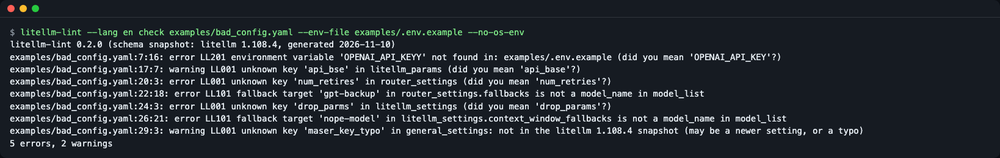
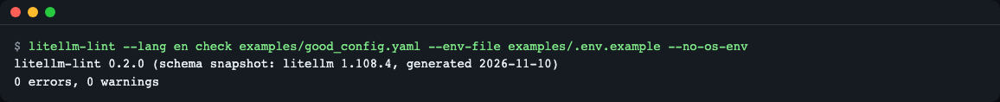
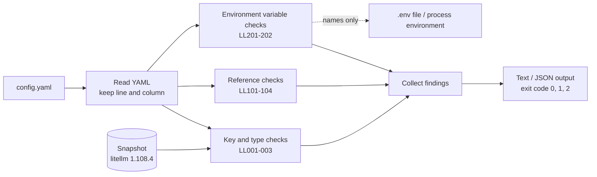

# litellm-lint

**English** | [한국어](README.ko.md)

A static linter for LiteLLM proxy `config.yaml` files (unofficial, not affiliated with LiteLLM). The proxy often silently ignores typos in its configuration; this tool reads `config.yaml` before you start the proxy and reports typo'd keys, missing `os.environ/` variables and fallbacks or aliases that point at a model that does not exist, with line numbers. It does not run the proxy, does not use the network, and does not read or print key values. Install: `uv tool install git+https://github.com/LeeGyeongPil/litellm-lint`, run: `litellm-lint check config.yaml`.

> This is an unofficial tool. The checks are based on a snapshot extracted from **litellm 1.108.4** (see "Supported versions and limits" below).


*The output of `litellm-lint check`, showing 5 typos and missing environment variables and 2 broken fallbacks with line numbers*

## Who it is for
- When you want `config.yaml` checked automatically in CI or pre-commit before deploying
- When you have had a typo like `num_retires` silently ignored without an error
- When you want to confirm that the model names written in `fallbacks` actually exist in `model_list`
- When you want to see beforehand whether the environment variables written as `os.environ/NAME` are defined in the deployment environment

## Installation
```bash
curl -LsSf https://astral.sh/uv/install.sh | sh        # if you do not have uv (Python 3.10 or later required)
uv tool install git+https://github.com/LeeGyeongPil/litellm-lint
litellm-lint --version
```
```
litellm-lint 0.2.0 (schema snapshot: litellm 1.108.4)
```
To try it once without installing: `uvx --from git+https://github.com/LeeGyeongPil/litellm-lint litellm-lint check config.yaml`. To use it from a downloaded repo, `git clone` and then `uv run litellm-lint ...`. A minimal Linux image needs `git` and `curl`.

## Quick start
You can try it right away with the repo's examples.
```bash
git clone https://github.com/LeeGyeongPil/litellm-lint && cd litellm-lint
uv run litellm-lint check examples/bad_config.yaml --env-file examples/.env.example
```
```
litellm-lint 0.2.0 (schema snapshot: litellm 1.108.4, generated 2026-11-10)
examples/bad_config.yaml:7:16: error LL201 environment variable 'OPENAI_API_KEYY' not found in: examples/.env.example, process environment (did you mean 'OPENAI_API_KEY'?)
examples/bad_config.yaml:17:7: warning LL001 unknown key 'api_bse' in litellm_params (did you mean 'api_base'?)
examples/bad_config.yaml:20:3: error LL001 unknown key 'num_retires' in router_settings (did you mean 'num_retries'?)
examples/bad_config.yaml:22:18: error LL101 fallback target 'gpt-backup' in router_settings.fallbacks is not a model_name in model_list
examples/bad_config.yaml:24:3: error LL001 unknown key 'drop_parms' in litellm_settings (did you mean 'drop_params'?)
examples/bad_config.yaml:26:21: error LL101 fallback target 'nope-model' in litellm_settings.context_window_fallbacks is not a model_name in model_list
examples/bad_config.yaml:29:3: warning LL001 unknown key 'maser_key_typo' in general_settings: not in the litellm 1.108.4 snapshot (may be a newer setting, or a typo)
5 errors, 2 warnings
```
Each line is `file:line:column: severity rule-code message`. The exit code is 1 if there are errors. A problem-free configuration ends like this.
```bash
uv run litellm-lint check examples/good_config.yaml --env-file examples/.env.example
```
```
litellm-lint 0.2.0 (schema snapshot: litellm 1.108.4, generated 2026-11-10)
0 errors, 0 warnings
```

*With no errors or warnings, the exit code is 0*

## Usage
```
litellm-lint check [--env-file PATH] [--no-os-env] [--strict] [--ignore CODES] [--format {text,json}] [--lang {en,ko}] config [config ...]
litellm-lint schema [-o PATH] [--lang {en,ko}]
litellm-lint --version
```

**Choosing the output language.** `--help`, error messages, findings and summary lines are shown in English or Korean. The first one that applies wins:

1. `--lang en|ko` (accepted before or after the subcommand: `litellm-lint --lang ko check ...` or `litellm-lint check --lang ko ...`)
2. the `LITELLM_LINT_LANG` environment variable (`en` or `ko`)
3. the locale: `LC_ALL`, `LC_MESSAGES`, then `LANG`; a value starting with `ko` (for example `ko_KR.UTF-8`) means Korean
4. otherwise English. An invalid `--lang` value stops the run with exit code 2; an invalid value in `LITELLM_LINT_LANG` is ignored and the next step is used.

```bash
uv run litellm-lint --lang ko check examples/good_config.yaml --env-file examples/.env.example
LITELLM_LINT_LANG=ko uv run litellm-lint check examples/good_config.yaml --env-file examples/.env.example
```
```
litellm-lint 0.2.0 (스키마 스냅숏: litellm 1.108.4, 생성일 2026-11-10)
오류 0건, 경고 0건
```
Only the text output is translated. `--format json`, the `schema` export, rule codes and exit codes are identical in both languages, so scripts that read the output should use `--format json` or pass `--lang en`. The Python API (`Diagnostic.message`) stays English.

| Command / option | What it does | Example |
|---|---|---|
| `check <config> [more ...]` | Checks configurations and prints findings. Several files allowed | `litellm-lint check a.yaml b.yaml` |
| `--env-file PATH` | Treats the **names** written in a dotenv file as "defined" (repeatable) | `--env-file .env.prod` |
| `--no-os-env` | Does not count the current shell's environment variables as defined | When checking against `.env` only in CI |
| `--strict` | Exit code 1 for warnings too | `--strict` |
| `--ignore CODES` | Skips comma-separated rule codes | `--ignore LL001,LL402` |
| `--format json` | Machine-readable JSON output (an array of per-file objects if there are several files) | `--format json` |
| `schema -o PATH` | Exports a JSON Schema (Draft 2020-12) for editors | `schema -o litellm.schema.json` |

Exit codes: `0` no problems (or only warnings), `1` errors present (including warnings with `--strict`), `2` usage error or input that cannot be read (YAML syntax error, a missing or broken `include` file, input that is too deep or too large = LL900). With several files, the exit code is the worst value (2 > 1 > 0).

When you give several files, the header appears once, each file gets its findings and a summary line, and a `total` line is added at the end.
```bash
uv run litellm-lint check examples/good_config.yaml examples/bad_config.yaml --env-file examples/.env.example
```
```
litellm-lint 0.2.0 (schema snapshot: litellm 1.108.4, generated 2026-11-10)
examples/good_config.yaml: 0 errors, 0 warnings
examples/bad_config.yaml:7:16: error LL201 environment variable 'OPENAI_API_KEYY' not found in: examples/.env.example, process environment (did you mean 'OPENAI_API_KEY'?)
examples/bad_config.yaml:17:7: warning LL001 unknown key 'api_bse' in litellm_params (did you mean 'api_base'?)
examples/bad_config.yaml:20:3: error LL001 unknown key 'num_retires' in router_settings (did you mean 'num_retries'?)
examples/bad_config.yaml:22:18: error LL101 fallback target 'gpt-backup' in router_settings.fallbacks is not a model_name in model_list
examples/bad_config.yaml:24:3: error LL001 unknown key 'drop_parms' in litellm_settings (did you mean 'drop_params'?)
examples/bad_config.yaml:26:21: error LL101 fallback target 'nope-model' in litellm_settings.context_window_fallbacks is not a model_name in model_list
examples/bad_config.yaml:29:3: warning LL001 unknown key 'maser_key_typo' in general_settings: not in the litellm 1.108.4 snapshot (may be a newer setting, or a typo)
examples/bad_config.yaml: 5 errors, 2 warnings
total: 2 files, 5 errors, 2 warnings
```

**Scenario 1 — block it in the deployment pipeline.** In CI without a `.env`, use a "list of variable names that must exist in the deployment environment" as the baseline, as in `--no-os-env --env-file deploy.env.example`. Below is the case where the typo rule is turned off with `--ignore LL001` and no environment variables are given at all.
```bash
uv run litellm-lint check examples/bad_config.yaml --no-os-env --ignore LL001
```
```
litellm-lint 0.2.0 (schema snapshot: litellm 1.108.4, generated 2026-11-10)
examples/bad_config.yaml:7:16: error LL201 environment variable 'OPENAI_API_KEYY' not found in: no sources
examples/bad_config.yaml:12:16: error LL201 environment variable 'OPENAI_API_KEY' not found in: no sources
examples/bad_config.yaml:22:18: error LL101 fallback target 'gpt-backup' in router_settings.fallbacks is not a model_name in model_list
examples/bad_config.yaml:26:21: error LL101 fallback target 'nope-model' in litellm_settings.context_window_fallbacks is not a model_name in model_list
examples/bad_config.yaml:28:15: error LL201 environment variable 'LITELLM_MASTER_KEY' not found in: no sources
5 errors, 0 warnings
```
Since no environment variable is defined, all 3 names referenced with `os.environ/` are caught as LL201.

**Scenario 2 — pass it to other tools as JSON.** `--format json` outputs (one object for one file, an array of objects for several) `tool`, `version`, `snapshot`, `file`, `summary` and `diagnostics[]` (code, severity, message, file, line, column, key, suggestion).
```bash
uv run litellm-lint check examples/good_config.yaml --env-file examples/.env.example --format json
```
```json
{
  "tool": "litellm-lint",
  "version": "0.2.0",
  "snapshot": {
    "litellm_version": "1.108.4",
    "generated_at": "2026-11-10"
  },
  "file": "examples/good_config.yaml",
  "summary": {
    "errors": 0,
    "warnings": 0,
    "info": 0
  },
  "diagnostics": []
}
```

**Scenario 3 — see it right in your editor.** If you make a JSON Schema with `litellm-lint schema -o litellm.schema.json` and attach it to a YAML editor (for example the YAML extension for VS Code), you can see key-name and type errors before saving. **Reference checks** such as fallbacks, aliases and environment variables **cannot be expressed in a schema**, so they work only in `check`.

**Scenario 4 — pre-commit.** This repo provides a `.pre-commit-hooks.yaml`. It checks only files named `config*.yaml` and takes all the files changed at once. Developer shells often have no API keys, so if you use a "list of variable names that must exist in the deployment environment" (`deploy.env.example`, a dotenv file with names only) as the baseline with `--no-os-env --env-file` as below, `os.environ/` references do not block commits with LL201.
```yaml
repos:
  - repo: https://github.com/LeeGyeongPil/litellm-lint
    rev: v0.2.0
    hooks:
      - id: litellm-lint
        args: [--no-os-env, --env-file, deploy.env.example]
```

**From Python.** The public API is `check_file`, `export_schema`, `Diagnostic`, `Report`, `Severity` and `LintUsageError`.

```python
from litellm_lint import check_file

report = check_file("examples/bad_config.yaml", env_files=["examples/.env.example"], use_os_env=False)
for d in sorted(report.diagnostics, key=lambda d: (d.line or 0, d.code)):
    print(d.line, d.code, d.message)
```

`report.diagnostics` is not sorted by line number, so you sort it yourself as above. The output is 7 items, and the first line is as follows (the same finding as in the `check` result above).

```text
7 LL201 environment variable 'OPENAI_API_KEYY' not found in: examples/.env.example (did you mean 'OPENAI_API_KEY'?)
```

## Configuration
There is no separate configuration file. Behavior is set only by the options above.
- Environment variable **values are not printed, even when read.** Only names are checked. `examples/.env.example` is an example with fake values, and the tool looks only at the names in it.
- LL201 looks for names in this order: the `--env-file` files, `environment_variables` inside the configuration, and (unless you gave `--no-os-env`) the current process environment.
- No API key is needed. You do not need to install litellm either.

## Rule codes
| Code | Default severity | What it catches |
|---|---|---|
| LL000 | info | The installed litellm version differs from the snapshot (1.108.4). It reads only package metadata and does not import litellm |
| LL001 | error / warning / info | Unknown key. If a similar key exists in the same section or the key belongs to another section, it is an error + suggestion; if nothing is similar, a warning (it may be a key from a newer version). Inside `litellm_params`, a warning if there is a suggestion, otherwise info |
| LL002 | error | Type or structure error (`num_retries: three`, `default_fallbacks: "gpt-main"`, a section that is not a mapping, a fallback list element that is not of the form `{source: [target, ...]}`, `include` that is not a list of paths, a top-level key that is not a string, a `model_list` entry missing `model_name`, `litellm_params` or `model`). `os.environ/NAME`, numeric strings and empty values are allowed |
| LL003 | error | `health_check_interval`/`health_check_concurrency` placed in `router_settings`. The proxy refuses to start; move them to `general_settings` |
| LL101 | error | A target of `fallbacks`, `context_window_fallbacks`, `content_policy_fallbacks` or `default_fallbacks` is not a `model_name` (wildcards and aliases are accepted). A warning if `store_model_in_db: true` or `model_list` is empty |
| LL102 | warning | A fallback's source group is not a `model_name` (`"*"` is allowed) |
| LL103 | error | A `model_group_alias` points to a group that does not exist |
| LL104 | warning | A group in `model_group_retry_policy` is not a `model_name` |
| LL201 | error | `os.environ/NAME` is not defined anywhere. Info if `key_management_system` is set |
| LL202 | warning | A value is written directly into a key such as `api_key`, `*_password`, `*_secret` or `*_token`. The value is not printed |
| LL301 | error | `general_settings.master_key` is **empty or a publicly known example key**. A warning if the bypass setting (`dangerously_permit_weak_or_unset_master_key: true`) is present |
| LL401 | warning | A duplicate whose `model_name` and `litellm_params` are exactly the same as an earlier deployment. Entries with the same name but different parameters are load balancing and are not flagged |
| LL402 | warning / info | The provider prefix of `litellm_params.model` is not in litellm's provider list. Skipped if `custom_llm_provider` is present |
| LL900 | error (exit 2) | Input cannot be read: YAML syntax error, nesting over 100 levels, over 500,000 nodes after alias expansion (alias bomb), a missing or broken `include` file (including chains over 50). Prints only line:column and a general description, and does not print the source line |

LL301 catches **only two cases, not weak keys in general.** The litellm 1.108.4 source (`master_key_boot_check.py`) rejects only "empty" and "matches the SHA-256 hash of a publicly known example key", with no length or complexity criteria, so the rule follows that criterion. This tool does not flag a short key other than `sk-1234`.

For detailed rule descriptions, see [docs/rules.md](docs/rules.md) (English).

## How it works

- **Reading YAML**: it reads with `ruamel.yaml` and remembers the line and column of every value, so findings carry positions.
- **Snapshot**: a key list (a JSON file) extracted by installing real litellm 1.108.4 and running `scripts/gen_snapshot.py`. The check does not import litellm, so it is fast and offline.
- **Key and type checks**: per section (`router_settings`, `litellm_settings`, `general_settings`, `litellm_params`) it checks whether keys are in the snapshot, and suggests similar names if any.
- **Reference checks**: the `model_name`s in `model_list` are the "model groups". It confirms the names that fallbacks, aliases and retry policies point to exist among the groups. Writing the same `model_name` several times is load balancing and is normal.
- **Environment variable checks**: it only checks whether the NAME in `os.environ/NAME` is defined.

## Supported versions and limits
- The key list is based on **litellm 1.108.4** (the 2026-11-05 to 2026-11-09 release window). Configuration keys of newer versions may appear as an "not in the snapshot" warning (LL001), and keys that disappeared in older versions cannot be known. If the installed litellm differs, an LL000 info appears.
- **It is a static check.** It does not start the proxy, and it does not check per-provider required parameters.
- It does not check the types of `litellm_settings` values (those values are settings that litellm assigns as they are, so this avoids false positives). Only the 4 fallback kinds are checked for list shape.
- Files split with `include` are followed, and the `model_name`s defined there are accepted as fallback and alias targets (the included files themselves are not checked, and a missing or broken file is LL900). Models stored in the DB are not supported. If you use DB models (`store_model_in_db: true`), the fallback-target check is a warning instead of an error.
- Input limits: nesting over 100 levels and over 500,000 nodes after alias expansion are rejected with LL900 (exit 2).
- Tested on Python 3.10, 3.12 and 3.14.

**Regenerating the snapshot** — to match a newer litellm, extract the snapshot anew in an isolated environment (with the repo cloned).
```bash
uv run --isolated --python 3.12 --with "litellm[proxy]==<버전>" python scripts/gen_snapshot.py --out src/litellm_lint/snapshots/
```
(`<버전>` is a placeholder for "version".)

You can run the full tests of the generation code with `LITELLM_LINT_ALLOW_LITELLM=1 PYTHONPATH=src python -m pytest tests/test_gen_snapshot.py` (only in an environment where litellm is installed).

## When to use it
- Use it when: you want to quickly check a configuration file for typos, broken references and missing environment variables file by file (several at once is possible) before deploying.
- Use another tool when: to check whether the proxy actually handles requests, use the startup and health checks in LiteLLM's [official documentation](https://docs.litellm.ai/docs/proxy/configs); to check only plain YAML syntax, use [yamllint](https://github.com/adrienverge/yamllint).

## Troubleshooting
| Symptom | Cause | Fix |
|---|---|---|
| `LL201 ... not found in: no sources` | `--no-os-env` was given without `--env-file` | Give a names-list file with `--env-file`, or remove `--no-os-env` |
| A new configuration key appears as an `LL001 warning` | A key from a version newer than the snapshot (1.108.4) | Regenerate the snapshot or use `--ignore LL001` |
| Exit code 2 and `LL900` | YAML syntax error, a missing or broken `include` file, input that is too deep or too large | Check the indentation and quotes near the reported line:column, and the `include` paths |
| pre-commit blocks the commit with `LL201` | The developer shell lacks that environment variable | Add `--no-os-env --env-file deploy.env.example` to the hook `args` |
| `LL202` warnings keep appearing | A key value is written directly in the configuration | Change it to `os.environ/NAME` |
| CI passes though there are only warnings | By default only errors count as failures | `--strict` |

## Development and contributing
```bash
git clone https://github.com/LeeGyeongPil/litellm-lint && cd litellm-lint
uv run pytest
```
```
98 passed, 1 skipped in 3.59s
```
The 1 skipped test is the full snapshot-generation test, which needs litellm. Please leave bugs and suggestions as issues. Change history is in [CHANGELOG.md](CHANGELOG.md).

## License
MIT. litellm is a separate project by BerriAI, and this tool extracts only the list of configuration key names from litellm and embeds it (no litellm code is included).
